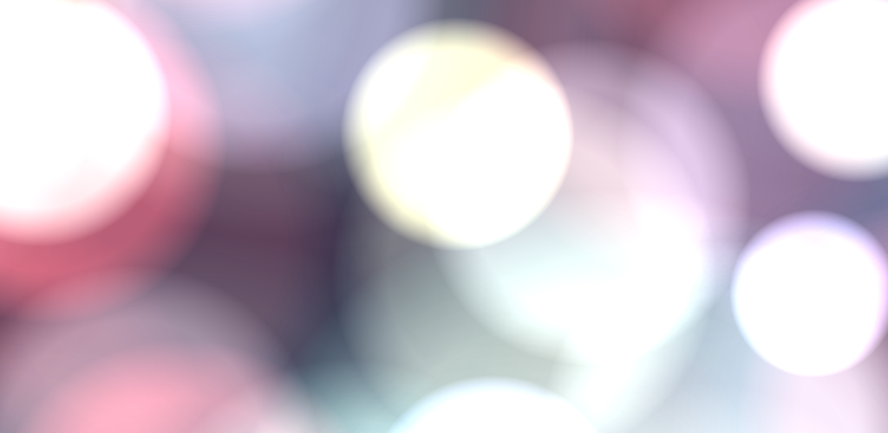
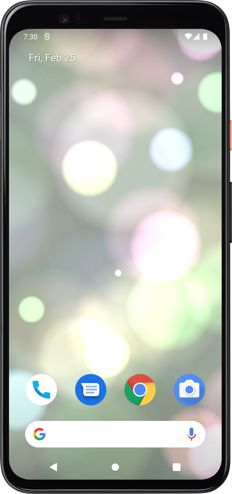
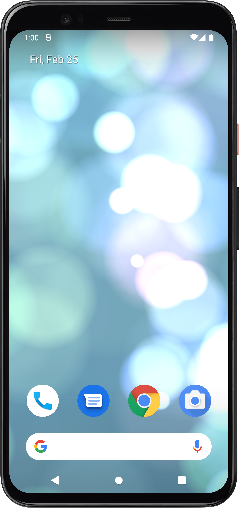
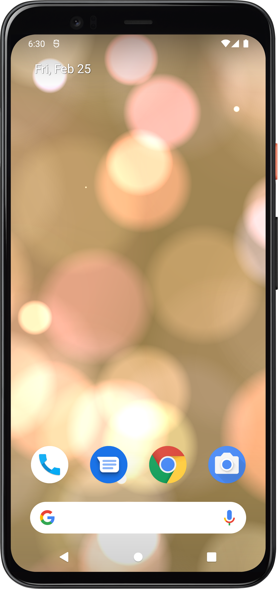
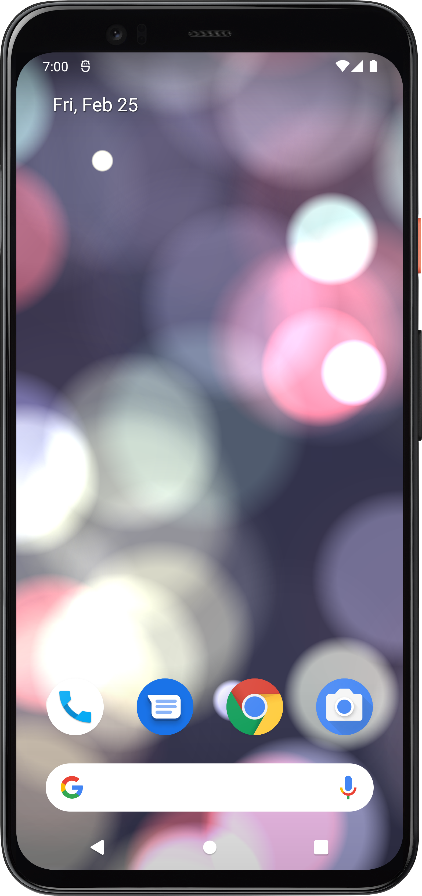

# Particles Live Wallpaper

Particles hanging in a space, viewed with a lens blur effect. Colors change in day/night cycle. Device motion sensors are used to move and rotate the view.

## Screenshots

  
  
  
  

# About the software design

The code is not intended to be beautiful,
to make the development process faster
as I couldn't allocate a lot of time to it
and it's not a large project either.
